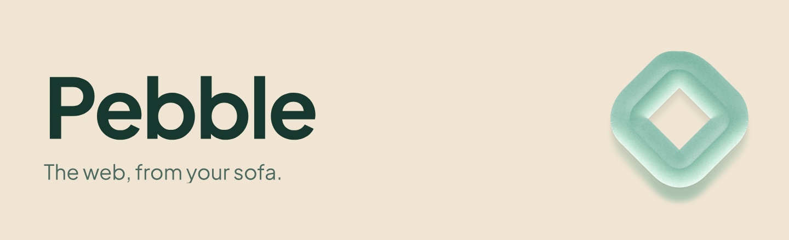
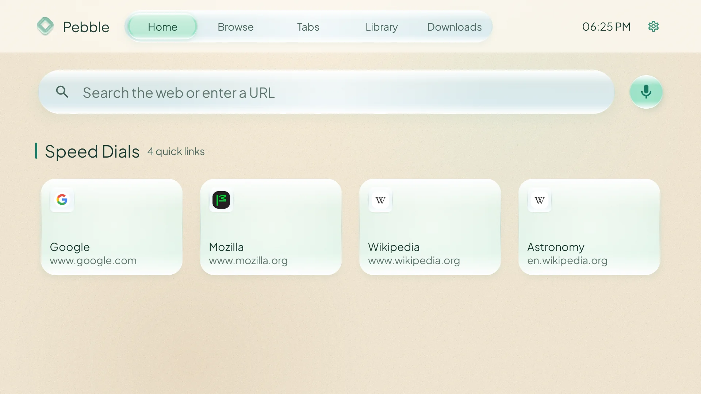
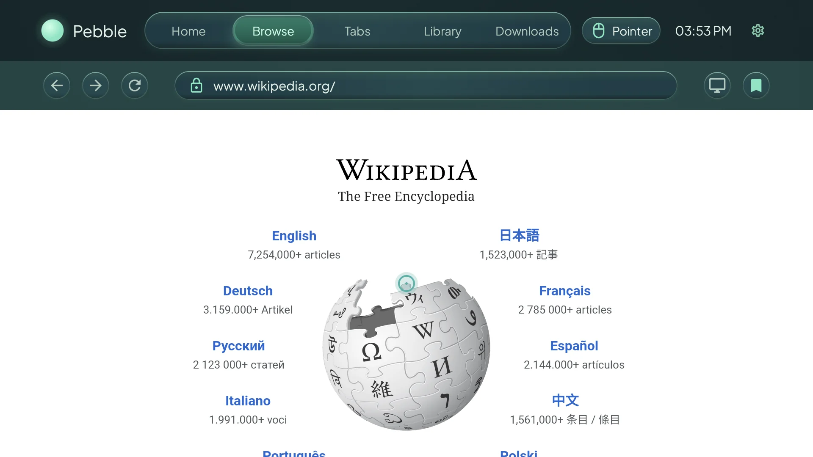
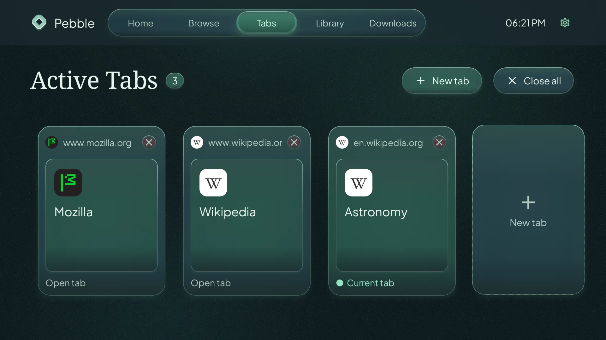
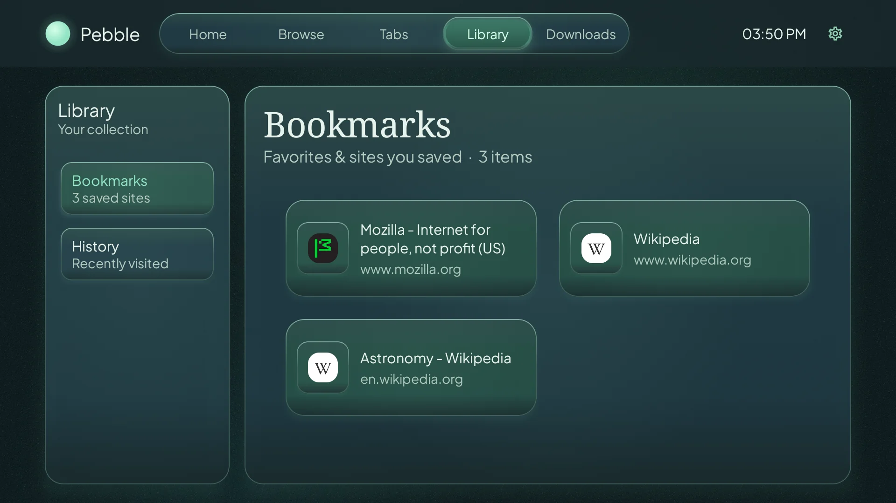
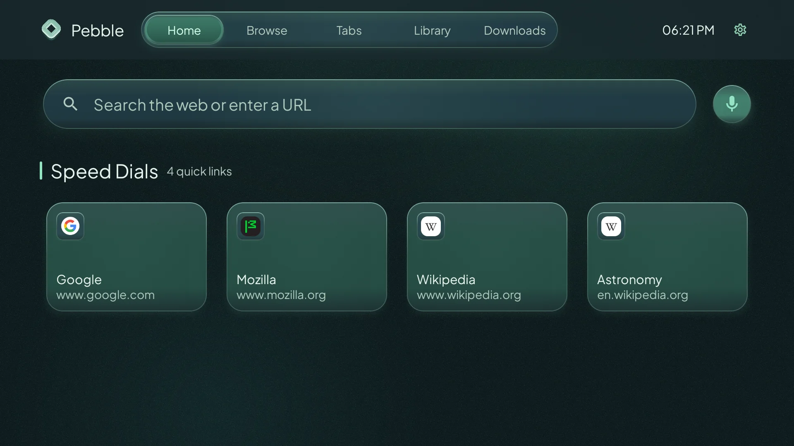

<picture>
  <source media="(prefers-color-scheme: dark)" srcset="docs/media/hero-dark.png">
  <source media="(prefers-color-scheme: light)" srcset="docs/media/hero-light.png">
  
</picture>

# Pebble for Android TV

Browse the web from your sofa, with controls made for your TV remote and a calm Sea Glass interface.

   
  <a href="https://github.com/itsvsk/pebble-tv-browser/releases/latest"><strong>Download the latest APK</strong></a>

**Android TV 7.0+** · Current Android System WebView · Install from an APK

  <a href="#try-it-on-your-tv">Installation</a>
  &nbsp; · &nbsp; <a href="#built-for-your-remote">Remote controls</a>
  &nbsp; · &nbsp; <a href="#gallery">Gallery</a>
  &nbsp; · &nbsp; <a href="#faq">FAQ</a>

  
  

**Development preview:** Real Android TV emulator captures with the new branding and an example browsing session. Speed Dials start empty and fill as you browse. The [v0.1.0 release](https://github.com/itsvsk/pebble-tv-browser/releases/tag/v0.1.0) uses the previous logo.

<picture>
  <source media="(prefers-color-scheme: dark)" srcset="docs/media/home-dark.webp">
  <source media="(prefers-color-scheme: light)" srcset="docs/media/home-light.webp">
  
</picture>

## Try it on your TV

1. **[Download the APK](https://github.com/itsvsk/pebble-tv-browser/releases/latest)** from the latest release. Choose the **`.apk` file** under **Assets**, rather than a source archive or mapping file.
2. **Transfer it to your TV** and open it with a file manager. Allow installation from that file manager if Android asks.
3. **Launch Pebble** from your TV's app launcher and start browsing.

For ADB commands, download verification, and update compatibility, see the [installation guide](docs/INSTALLING.md).

## Built for your remote

Move the pointer with the **D-pad** and press **OK / Select** to activate a link. Keep pressing toward a page edge to scroll. Move **Up at the top of the page** to reveal the browser controls.

- **Hold Select** to open supported site, tab, bookmark, and history context menus.
- **Back** returns focus to the active top navigation item on native screens.
- **Switch navigation modes** using Browse's navigation control; pages start in pointer mode.
- **Edit a URL or search** by selecting the browser address field, or use **Clear address** to replace it. Top navigation wraps at both ends.

## Make yourself at home

- **Return to favorite pages:** Speed Dials grow from your browsing history; bookmarks keep sites you choose to save.
- **Keep pages open:** Switch between tabs and find previously visited pages in History.
- **Search your way:** Enter a URL or search query, or use voice search when a speech-recognition service is available.
- **Adjust website behavior:** Try mobile or desktop mode and toggle **Block ads & trackers** when needed.
- **Follow your downloads:** Get start, completion, and failure alerts, check progress in Downloads, and choose an app when opening a saved file.
- **Choose your surroundings:** Use the warm sand and sea-glass Light theme, the deep green Dark theme, or follow your TV's appearance. Themes change Pebble's interface; websites keep their own appearance.

## Gallery

Expand a capture to see it at full width. These show the same development build and example session as the Home preview above.

<strong>Tabs — switch between open pages</strong>

<strong>Bookmarks — saved places to return to</strong>

<strong>Light and Dark — two ways to feel at home</strong>

**Light:** Warm sand and sea-glass greens.

**Dark:** Deep green surfaces and mint highlights.

## FAQ

<strong>Why are my Speed Dials empty?</strong>

Pebble starts with no preinstalled Speed Dials. Visit a few sites and your frequently visited pages will appear on Home. The screenshots show an example session.

<strong>What if a website doesn't work?</strong>

Website compatibility depends on your TV's Android System WebView. Keep it current, try switching between mobile and desktop mode, or toggle **Block ads & trackers** and reload the page. If the issue persists, [report it](https://github.com/itsvsk/pebble-tv-browser/issues) with the site address, TV model, and Android version.

<strong>Does clearing history sign me out of websites?</strong>

Clearing local browsing history affects Speed Dials, which use that history. It does not clear cookies or website sessions.

<strong>Is private browsing available?</strong>

Private browsing is currently unavailable.

<strong>Why isn't voice search available on my TV?</strong>

Voice search needs an installed speech-recognition service. You can still type a URL or search query.

<strong>How do I update Pebble?</strong>

Download and install the newer release APK. Updates must use the same signing key as the installed app. Official release APKs share a signing key; a build signed with a different key cannot update it in place. See the [installation guide](docs/INSTALLING.md) for details.

## Help shape Pebble

Found a website that behaves unexpectedly, or have an idea for better remote browsing? [Open an issue](https://github.com/itsvsk/pebble-tv-browser/issues). Include your TV model, Android version, and steps to reproduce when reporting a bug.

For development, see the [build and architecture guide](docs/DEVELOPMENT.md), [release guide](docs/RELEASING.md), and [changelog](CHANGELOG.md). Logo files and usage are in the [brand guide](docs/BRANDING.md).

---

Built with Kotlin and Jetpack Compose for Android TV.

With thanks to [mttmcknn/sea-glass](https://github.com/mttmcknn/sea-glass) for the sea-glass design inspiration and the rendering model used to create Pebble's textured logo finish.

No application license has been selected yet. Plus Jakarta Sans is bundled under the [SIL Open Font License](core/design/licenses/plus-jakarta-sans-OFL.txt). [Artwork and screenshot sources](docs/media/README.md).
