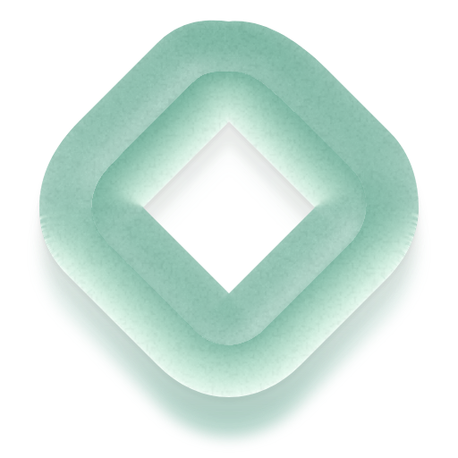

# Pebble identity

The approved logo is **Tidal Lens**, in **Tumbled Jade with subtle pebble texture**. A softened stone surrounds a diamond-shaped opening; fine mineral grain, shallow pores and gentle transmitted light give the surface depth.



## Source of truth

- [Approved material master](branding/pebble-logo-master.png): original 704 × 704 transparent rendering, unchanged from the approved draft.
- [Production mark](branding/pebble-logo.png): 512 × 512 crop retaining the solid mark and downward light.
- [Flat vector](branding/pebble-logo-flat.svg): the same silhouette and aperture for one-color or very small uses.
- [Material recipe](branding/recipe.json): palette, lighting, grain and relief parameters.
- [Product artwork in Figma](https://www.figma.com/design/d7FAOeaVLFybYFWwpCj48a): editable wordmarks and layouts with the approved logo as an image layer.

Use the colored production mark on warm sand (`#F0E5D2`) or deep sea green (`#0D1A1C`). Preserve its aspect ratio, transparent opening, color, surface finish and light direction. Keep at least one-quarter of the solid mark's width clear of unrelated content. The app header uses a 28dp image; avoid trying to reproduce the texture below that size, where the flat vector is more suitable.

## App assets

The shared `PebbleLogo` composable uses a cached static drawable on every native screen. Material lighting and grain are baked in; the app does not run the logo renderer or depend on the Sea Glass library.

Android 8+ uses separate foreground and background adaptive-icon layers. The solid mark fits within a 60dp area on its 108dp layer. Density-specific legacy icons cover Android 7. TV banners include both the mark and the wordmark, with 16:9 artwork from 160 × 90 through 640 × 360. These follow the [Android TV icon and banner guidance](https://developer.android.com/design/ui/tv/guides/system/tv-app-icon-guidelines).

Regenerate the drawable, adaptive foreground, legacy icons, TV banners and hero SVG image layers after changing the approved master:

```sh
python3 -m pip install Pillow
python3 tools/generate_brand_assets.py
```

Run from the repository root. The tool uses the bundled Plus Jakarta Sans font for the banner wordmark. Hero SVG files retain outlined typography; after regeneration, render each to a 1440 × 440 PNG using an SVG renderer, and update the checked-in PNG alongside its SVG source. The README uses PNG exports for consistent GitHub rendering of the textured mark.

The original 704px master includes the renderer's transparent gutter. Do not use the full gutter as the visible logo's app bounds or trim only the solid shape: the latter crops the transmitted light. The fixed crop in the generator has been checked against the image's alpha bounds. Adaptive icon masks and raster exports need separate optical sizing; keep the foreground inside the safe zone.

## Rendering provenance and licenses

The finish was created with an adaptation of [mttmcknn/sea-glass's optical model](https://github.com/mttmcknn/sea-glass/blob/db70d7197e8ee43ffaf4ef05db6a1b61cb59dec8/web/dist/sea-glass.mjs), using the custom Tidal Lens outline and even-odd aperture. Height smoothing was widened for the hollow geometry; low-contrast, seeded mineral relief was added without displacing the outline. Upstream [Apache 2.0 license](branding/LICENSE.sea-glass.txt) is retained for provenance. The renderer is a design-time source, not shipped executable code. This attribution does not assign a license to the Pebble trademark or to the rest of the repository.

Wordmarks use Plus Jakarta Sans, licensed under the [SIL Open Font License](../core/design/licenses/plus-jakarta-sans-OFL.txt). Figma uses a compact full-color PNG preview to fit its connector's upload limit; checked-in app and README artwork uses the full-resolution PNG master. Earlier Stitch handoff files are historical prototypes and are superseded by this identity.
